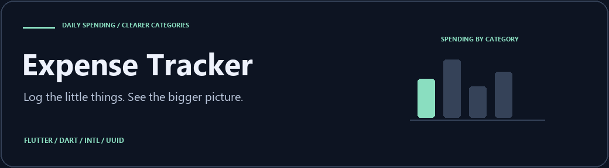

<div align="center">



# Expense Tracker

**Log the little things. See the bigger picture.**


[Overview](#overview) &nbsp; · &nbsp; [Run locally](#run-locally) &nbsp; · &nbsp; [Explore the repository](https://github.com/mcampo0215/expense_tracker_app)

</div>

---

## Overview

A Flutter expense-tracking interface with categorized entries, a visual spending chart, and an adaptive layout. Add an expense, review its category, or swipe an entry away and undo the deletion.

| Capture | Compare | Adjust |
| :--- | :--- | :--- |
| Enter a title, positive amount, date, and spending category. | See category totals in the chart alongside individual entries. | Delete an expense with a short undo window. |

## Run locally

Use Flutter with Dart compatible with `^3.10.4`, then:

```sh
flutter pub get
flutter devices
flutter run
```

## What to try

1. Use the plus button to open the expense form.
2. Choose **food**, **travel**, **leisure**, or **work**, then save a valid title, amount, and date.
3. Review the category chart and swipe a record to delete it.
4. Tap **Undo** within the three-second snackbar window to restore it.

The layout places the chart above the list on smaller screens and beside it when the width exceeds 600 logical pixels.

## Explore the code

| Source | Responsibility |
| :--- | :--- |
| [lib/models/expense.dart](lib/models/expense.dart) | Expense IDs, categories, date formatting, and category totals. |
| [lib/widgets/expenses.dart](lib/widgets/expenses.dart) | In-memory entries, add/delete actions, undo, and responsive layout. |
| [lib/widgets/new_expense.dart](lib/widgets/new_expense.dart) | Validated expense form. |
| [lib/widgets/chart/](lib/widgets/chart/) | Category chart components. |

## Current scope

The app starts with three sample expenses. Entries are stored in widget state, so changes do not persist across an app restart. There is no bank connection, account sync, or backend in this repository.

## Development

```sh
flutter analyze
flutter test
```

---

<p align="center"><a href="#expense-tracker">Back to the top</a></p>
